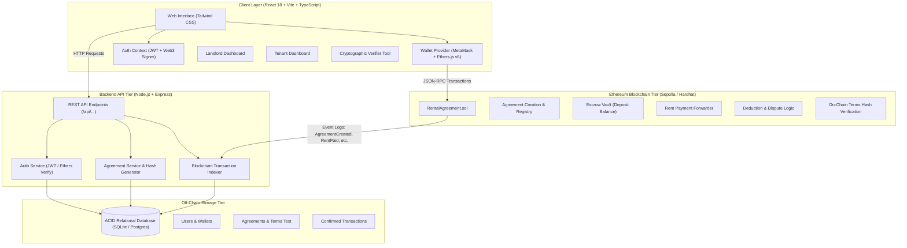
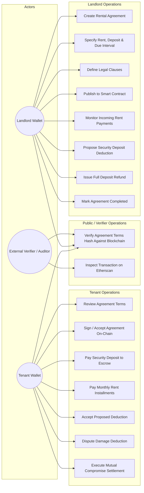
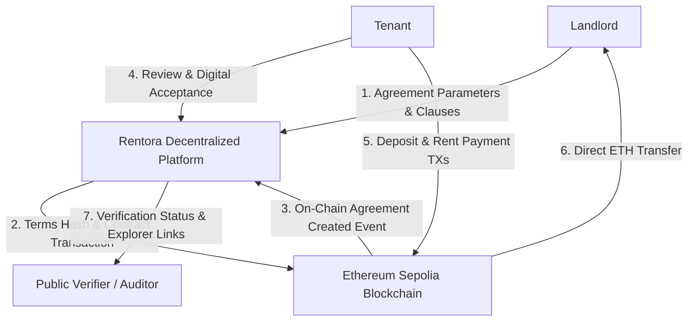
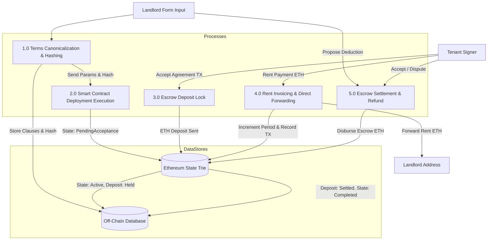
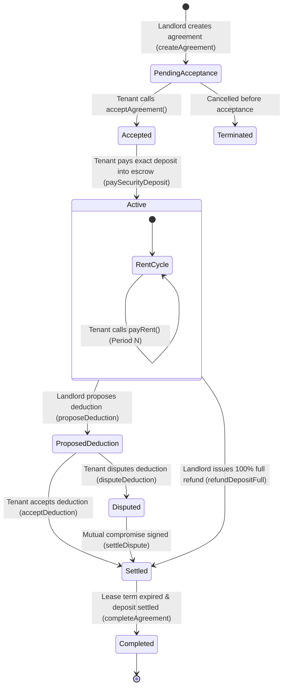
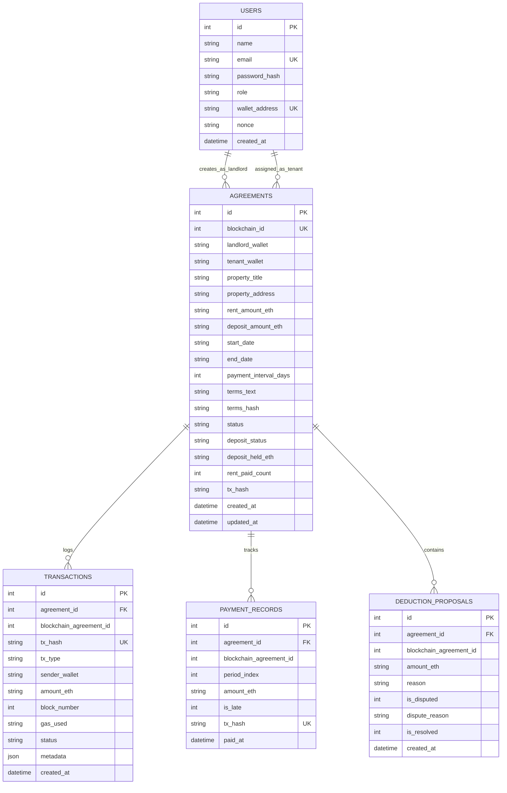
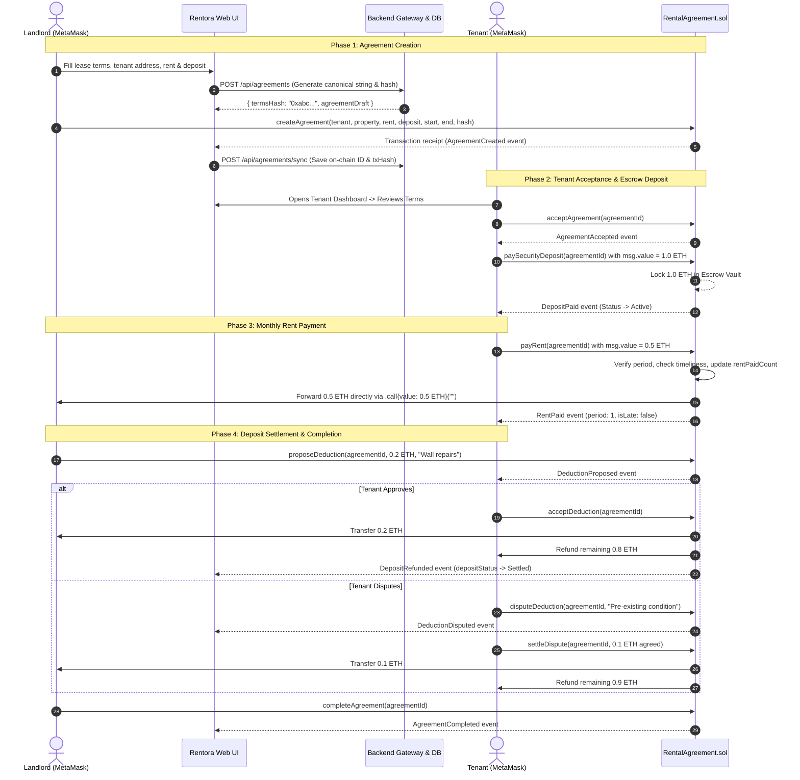

# Rentora System Architecture & Engineering Diagrams
> **Smart Renting. Secure Agreements.**

All diagrams below are rendered in editable, standard Mermaid format.

---

## 1. System Architecture Diagram

---

## 2. Use Case Diagram

---

## 3. Data Flow Diagram (DFD Level 0 & Level 1)

### Level 0 Context Diagram

### Level 1 Data Flow Diagram

---

## 4. Smart Contract Workflow & State Transition Diagram

---

## 5. Database Entity-Relationship Diagram (ERD)

---

## 6. End-to-End Blockchain Transaction Sequence

